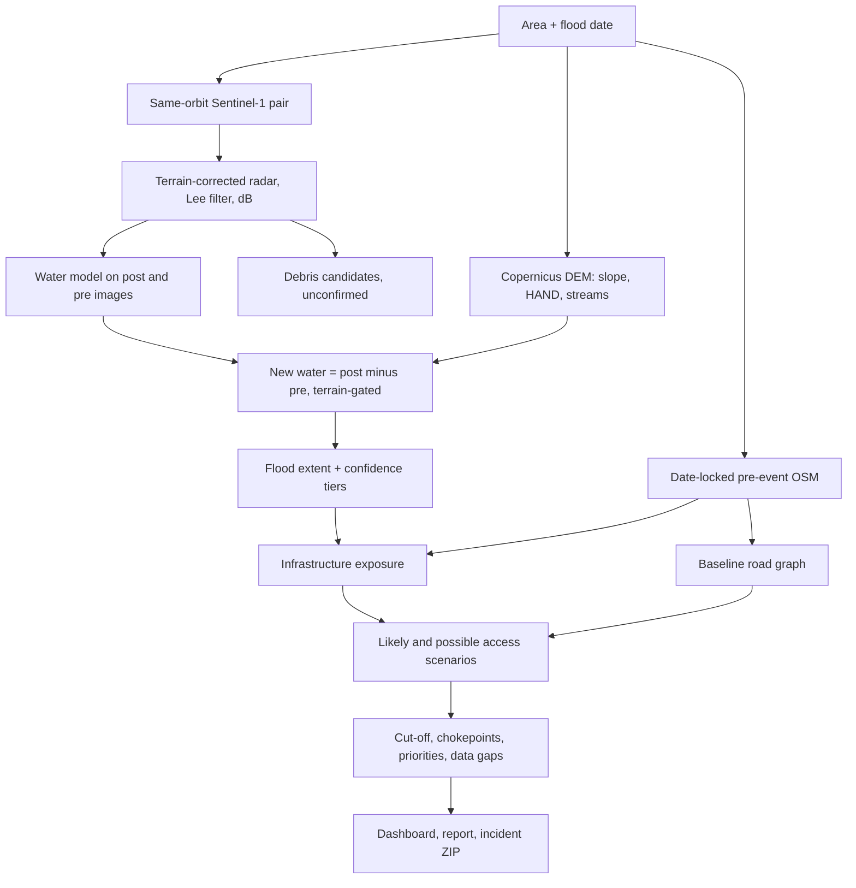

# FloodIntel

**From satellite flood evidence to mapped access consequences.**

Multimodal AI Hackathon 2026 · Track B: Mapping Flood Damage from Space

> **Educational prototype. Not operational emergency infrastructure.**
> A satellite flood-extent intersection means *potential inundation or exposure*, not confirmed structural damage. Road removals are scenarios. Missing routes in OpenStreetMap are data gaps, not evidence of flood isolation.

## What it does

Give FloodIntel an **area** (place name or bounding box) and a **flood date**. It runs one chain, end to end, from raw allowed data:

1. **Pairs Sentinel-1 radar images** from before and after the flood, from the *same orbit*, so a different viewing angle is not mistaken for change.
2. **Estimates new water** with a trained segmentation model run on both images: new water = water after minus water before. A terrain gate (height above nearest drainage, slope) removes implausible pixels.
3. **Checks mapped infrastructure** (roads, bridges, buildings) from a date-locked, pre-event OpenStreetMap snapshot against the flood extent.
4. **Treats the road network as a graph.** It compares baseline access to hospitals and towns with access after removing flooded links, and names the link responsible, any detour, and which single link would reconnect the most settlements.
5. **Writes a static dashboard, a one-page situation report and a portable ZIP**, with evidence, quality flags and provenance attached to every result.

The application is a Python command-line pipeline with static HTML output. It is not a hosted service, and it calls no LLM at runtime: all report text is generated from computed numbers.

## Results at a glance

### Model benchmark (Sen1Floods11 water segmentation)

U-Net with a ResNet34 encoder (ImageNet initialization), two post-event bands (VV, VH), 30 epochs, best epoch 10, threshold 0.6.

| Split | Water IoU | F1 | Precision | Recall |
| --- | ---: | ---: | ---: | ---: |
| Validation | 0.645 | 0.785 | 0.801 | 0.769 |
| Test | 0.659 | 0.795 | 0.803 | 0.787 |
| Bolivia (region holdout, 15 chips) | 0.593 | 0.744 | 0.861 | 0.655 |

Validation and test chips are disjoint from training chips but **share regions with training**, so they flatter the model. Bolivia is the only unseen region and is small. These numbers measure water segmentation on dataset chips, not flood change or access accuracy.

### Trishuli case study (flood of 26 August 2026)

Incident `inc_e9ee823f659c`. Sentinel-1 ascending relative orbit 85, pre 2026-08-16, post 2026-08-28 (2 days after the event).

| Output | Result |
| --- | --- |
| New water (flood candidate) | 0.30 km² (strong 0.004, probable 0.226, uncertain 0.066) |
| Pre-existing water, subtracted | 1.09 km² |
| Removed by the terrain gate | 0.33 km² (40.4% of new-water pixels) |
| Debris candidates (unconfirmed) | 6.39 km² |
| Roads / bridges / buildings potentially inundated | 1 / 1 / 5 |
| Settlements CUT OFF / UNCERTAIN / CONNECTED | 0 / 54 / 168 |

The 54 UNCERTAIN settlements (24.3%) match the share of settlements with no mapped baseline route to a hospital or town, so they are **OSM data gaps, not flood effects**. With debris candidates added as weak (tier-1) evidence, 254 roads, 37 bridges and 1,345 buildings are potentially affected, still with 0 CUT OFF.

As a pipeline check on a different continent, the same command ran end to end on the September 2023 Larissa, Greece flood and produced 38.8 km² of new water. That run was not compared with any reference.

### Post-hoc comparison with Copernicus EMS EMSR927

Run **after** inference, from a separate script that is never imported by the analysis. The reference polygons (AOI03, observed event) are labelled **Mass Movement / Landslide**, so this is a **proxy check, not a flood-extent validation**. It is scored inside the reference's analysed domain (18.48 km²). 95.8% of our flood area falls outside that domain. The reference's acquisition date is absent from its metadata.

| Variant | IoU | Precision | Recall | F1 | Ours km² | Overlap km² |
| --- | ---: | ---: | ---: | ---: | ---: | ---: |
| flood mask | 0.0021 | 1.00 (124 pixels) | 0.0021 | 0.0042 | 0.0124 | 0.0124 |
| debris candidates | 0.4011 | 0.9405 | 0.4115 | 0.5725 | 2.577 | 2.423 |
| union | 0.4031 | 0.9408 | 0.4136 | 0.5746 | 2.589 | 2.436 |

Reference area is 5.89 km². All rows are shown and none is labelled best. The debris and union rows were added **after** the flood-only result came back weak. Debris candidates are defined as backscatter change within 200 m of streams, and the domain is a narrow strip around the river, so part of that overlap is built in. About 3.8 km² of candidates lie outside the domain and are unscored. No threshold was tuned against the reference.

### What this means

On the Trishuli event the flood model **under-detects**: it found 0.30 km² of new water against a 5.89 km² reference event. Likely causes, none of them tested: the event was a glacier-collapse debris flow (mud, ice, rock) that does not look like open water to radar; a processing gap between the training chips and our terrain-corrected input; and a terrain gate that is strict in a mountain valley. The access analysis is working as designed, but on this input it reports no cut-off settlements, and it says so.

## How it works



Design choices that matter:

- **Same orbit only.** Pairs must share orbit direction and relative orbit. If none exists, the run is blocked with a reason, not faked.
- **Terrain-corrected radar preferred.** If it is unavailable, both passes fall back to uncorrected data with an explicit low-confidence warning.
- **Pre-event water is subtracted, not trusted.** The training data has post-flood chips only, so the same two-band model is run on the pre image and its water is removed.
- **Date-locked OSM with verification.** Overpass is queried at the flood date, and every returned element's timestamp is checked. A mirror that returns newer edits is rejected.
- **Baseline first.** A settlement with no mapped route to a hospital or town before the flood can never be reported CUT OFF. It goes to a separate data-gap list.
- **Honest labels.** CUT OFF needs lost baseline access in the *likely* scenario (flood evidence tier 2 or higher). Weaker evidence gives UNCERTAIN. Debris candidates only ever count as weak evidence.
- **Priorities are not need estimates.** They rank settlements that have flood-attributable evidence and are built from mapped-building counts (a size proxy, not population). Nothing in the system estimates casualties.

## Quick start

### 1. Install

```bash
git clone https://github.com/Ayush024-git/floodintel.git
cd floodintel
python3 -m venv .venv
.venv/bin/python -m pip install -r requirements.txt
.venv/bin/python -m pytest -q
```

Run subsequent commands from the cloned `floodintel` root folder. `.venv/bin/python` uses the virtual environment without activation. Developed on Python 3.14 on macOS. Some geospatial wheels may need Python 3.12 or 3.13 on other platforms; `docs/TRAINING.md` documents that setup. Dependencies are not pinned.

### 2. Get a model checkpoint

Download `best.pt`, `config.json` and `metrics.json` from [Apex024/floodintel-expA on Hugging Face](https://huggingface.co/Apex024/floodintel-expA/tree/main). Create `runs/expA/` inside the repository and put all three files there, keeping their names unchanged. The checkpoint path must be `runs/expA/best.pt`. Checkpoints and datasets are not in GitHub. You do not need the training dataset or a new training run to use this released model. To train your own, see `docs/TRAINING.md`.

### 3. Run an analysis

```bash
.venv/bin/python -m src.run --place "Trishuli, Nepal" --date 2026-08-26 --checkpoint runs/expA/best.pt
```

This runs all four stages: incident preparation, flood map, impact and dashboard. For another event, change the place and flood date (`YYYY-MM-DD`). Alternatively, use bounds in **west, south, east, north** order:

```bash
.venv/bin/python -m src.run --bbox 84.99 27.79 85.30 28.06 --date 2026-08-26 --checkpoint runs/expA/best.pt
```

A new area downloads radar, elevation and OSM data. OSM took about **6–25 minutes** in our runs, sometimes longer when mirrors were slow; cached reruns take seconds. Buildings are skipped by default; add `--with-buildings` to include them, which adds time.

Wait for the dashboard stage to finish. A successful run prints **`Incident:`**, **`Dashboard:`** and report paths. If it stops or is blocked, read the printed reason before trying to open a new report.

Other options: `--validation-json PATH` adds a reporting-only comparison; `--cache-dir` changes the output cache; `--force` refreshes the incident receipt while downstream caches remain active. No validation JSON is needed for the normal demo.

### 4. Find the incident ID and open the results

The pipeline generates the ID and prints it after `Incident:`, for example `Incident: inc_e9ee823f659c`. Copy the ID from **your own run**. Wherever this README uses `<incident_id>`, replace it with that value, without angle brackets. The easiest option is to copy the complete path after **`Dashboard:`** and open it; the path already contains your ID.

On macOS, the published Trishuli report opens with:

```bash
open "data/cache/incidents/inc_e9ee823f659c/report/index.html"
```

Use that example only if your report has that ID; otherwise use your printed dashboard path. On Linux, use `xdg-open` instead of `open`, or double-click `index.html` in your file manager. A custom `--cache-dir` also changes the path.

No server is required. The interactive map loads a library from a CDN; offline, the SVG fallback map and tables still work. Print `situation_report.html` to PDF from the browser. Opening a saved report does not rerun the analysis.

### 5. Explore the demo

- Check the incident heading and satellite dates, then inspect the flood confidence legend in **Impact**.
- In **Infrastructure**, enable roads, hospitals and settlements; select a feature to inspect its evidence and access details.
- Open **Isolation** for connected, cut-off and uncertain cases. Missing baseline routes are data gaps, not confirmed flood isolation.
- Review **Trust** and **Provenance** for limitations and input sources. Debris candidates require inspection; **Validation** appears only when a comparison was supplied.

### Individual stages (optional)

The normal demo only needs `src.run` above. For individual stages, run the first line below, then copy `"incident_id"` from its printed JSON and confirm `"status"` is `"ready"`. Replace the ID placeholder before running the remaining lines in the same terminal session.

```bash
.venv/bin/python -m src.data.incident --place "Trishuli, Nepal" --date 2026-08-26
INCIDENT_ID="REPLACE_WITH_YOUR_PRINTED_INCIDENT_ID"
.venv/bin/python -m src.analysis.flood_map --incident "$INCIDENT_ID" --checkpoint runs/expA/best.pt
.venv/bin/python -m src.graph.impact --incident "$INCIDENT_ID"
.venv/bin/python -m src.report.dashboard --incident "$INCIDENT_ID"
```

For graph inspection, `--list-critical-bridges` lists bridge/link IDs. Synthetic scenarios using `--test-link <link_id>` or `--test-polygon W S E N` write to `impact_test/` with a **SYNTHETIC TEST INPUT, NOT A MODEL RESULT** banner. `--include-debris-candidates` adds debris candidates as weak evidence in `impact_debris/`.

## Outputs

Everything for one run lives under `data/cache/incidents/<incident_id>/`:

- `incident.json`, `summary.md`: manifest, stage timings, quality flags, provenance receipt
- `flood/<key>/`: `flood.tif` (probabilities and audit layers), `flood_meta.json`, `flood_extent.geojson`, `debris_candidates.geojson`, `quicklook.png`
- `impact/<key>/`: `damaged_assets.geojson`, `settlements.geojson`, `routes.geojson`, `clusters.json`, `chokepoints.json`, `priorities.json`, `impact_meta.json`
- `report/`: `index.html`, `situation_report.html`, `situation_report.md`, `incident_package.zip` (originals plus provenance, for low-bandwidth sharing)

Dashboard views: **Impact, Infrastructure, Isolation, Chokepoints, Priorities, Trust, Provenance**, plus **Validation** when a comparison is supplied. Clicking a settlement, link or bridge opens an evidence drawer with baseline and post-flood access times, the responsible link, whether restoring it alone reconnects the settlement, the detour, the evidence tier and the quality flags that apply. Display geometry is simplified and capped (for example 2,000 roads); the ZIP keeps the full data.

## Data and compliance

Allowed inference inputs: Sentinel-1 (radar), Copernicus DEM GLO-30, pre-event OpenStreetMap, and the permitted training dataset (Sen1Floods11). Sentinel-2 is on the allow-list but **no Sentinel-2 processing is implemented**.

Not used as inference input: Copernicus EMS or UNOSAT damage maps, other published damage maps, or any post-event OSM edits.

- Each incident records every input's source, dates and OSM snapshot timestamp. A run only becomes `ready` after an allow-list check and OSM snapshot verification.
- The EMSR927 comparison lives in `eval/compare_emsr927.py`, outside `src/`. Only an explicitly supplied comparison JSON reaches the report; it never enters scene selection, inference, graph analysis or ranking.
- `tests/test_no_leak.py` scans every Python file in `src/` (comments included) for forbidden reference-data names. This is a source guard, not a proof about information flow.

To reproduce the comparison, obtain the EMSR927 AOI03 grading product (observed event, area of interest and not-analysed polygons) from Copernicus EMS, place the shapefiles in `eval/emsr927/` (they are not redistributed), then:

```bash
.venv/bin/python eval/compare_emsr927.py --incident "$INCIDENT_ID" --flood "data/cache/incidents/$INCIDENT_ID/flood/<key>/flood.tif" --tolerance-m 50
.venv/bin/python -m src.report.dashboard --incident "$INCIDENT_ID" --validation-json "eval/results/$INCIDENT_ID/comparison.json"
```

Set `INCIDENT_ID` as explained above. Replace `<key>` with the folder name in the flood-map stage's printed `cache_path`, or use that full `flood.tif` path for `--flood`. This comparison is optional. The 50 m tolerance metrics measure closeness, not overlap, and are reported as secondary.

## Model and training

- Binary water segmentation, U-Net with a ResNet34 encoder (segmentation-models-pytorch), two input bands (post VV and VH in dB, clipped to [-35, 5] and normalized with training-split statistics stored in the checkpoint).
- Loss: class-weighted BCE plus soft Dice, ignoring invalid pixels. AdamW with warmup and cosine decay, early stopping, checkpoints store configuration, normalization and threshold.
- Training data: Sen1Floods11 hand-labeled chips with the official split files. There is no random split. Training ran on a Kaggle GPU; devices auto-select CUDA, then Apple MPS, then CPU.
- Inference: 512-pixel tiles with 128-pixel overlap and smooth blending, so large scenes run without seams.
- One augmentation experiment (speckle filtering plus brightness jitter) scored no better on the benchmark (Bolivia IoU 0.583 vs 0.593), and its checkpoint was not recovered, so it is not used.

To fetch the training data (public bucket, hand-labeled subset only):

```bash
mkdir -p data/external/sen1floods11 && cd data/external/sen1floods11
gsutil -m cp -r gs://sen1floods11/v1.1/data/flood_events/HandLabeled/S1Hand .
gsutil -m cp -r gs://sen1floods11/v1.1/data/flood_events/HandLabeled/LabelHand .
gsutil -m cp -r gs://sen1floods11/v1.1/splits .
```

## Key parameters (all echoed in output metadata)

| Parameter | Default |
| --- | --- |
| Pair search window | 60 days before to 12 days after; same orbit; at least 50% coverage, 95% preferred |
| Flood threshold | the checkpoint's stored value (0.6 for the released model) |
| Terrain gate | height above drainage at most 15 m, slope at most 20° |
| Darkening support | 3 dB in VV or VH (supporting evidence, not a hard gate) |
| Cleanup | components below 50 pixels removed; holes below 50 pixels filled |
| Debris candidates | 3 dB change, within 200 m of streams, slope 0 to 15° |
| Road exposure | at least 20 m of overlap or 10% of segment length; bridges use a 30 m buffer |
| Scenarios | likely: evidence tier 2 or higher; possible: tier 1 or higher |
| Point snapping | nearest graph node within 1,500 m |
| Degraded access | route time more than 1.5× baseline |
| Building size proxy | nearest-settlement assignment within 300 m |

These are documented exploratory heuristics, not calibrated values.

## Testing

```bash
.venv/bin/python -m pytest -q
```

415 tests pass. They use synthetic rasters, small graphs, fake models and mocked acquisition, so they need no network. They cover same-orbit refusal, timestamp locks, cache reuse, masked losses, tiled inference, graph junctions, baseline-only uncertainty, data-gap exclusion, report number tracing (every number in the report must trace to an input file), HTML escaping and the reference-data leak guard. This is software verification, not a claim of disaster-mapping accuracy.

## Limitations

- **Under-detects the Trishuli event** (see results). The cause is unconfirmed.
- **Processing-domain gap:** training chips and our terrain-corrected, filtered input were produced differently; transfer is unvalidated. Probabilities are uncalibrated.
- **Pre-event water** is classified water that overlaps in both images, not a verified permanent-water map.
- **Terrain heuristics:** the DEM is a surface model (canopy and buildings included), and fixed thresholds can remove real inundation in valleys. In Trishuli the gate removed 40.4% of new-water pixels.
- **Needs a same-orbit pair.** Without one the run is blocked. Satellite revisit gaps can miss short-lived floods, and radar cannot reliably identify debris.
- **OpenStreetMap is volunteer-mapped:** in Trishuli 76.9% of road ways were last edited more than five years before the snapshot, and 24.3% of settlements have no mapped baseline route to a hospital or town. Timestamp verification prevents using post-event edits but cannot prove completeness.
- **Road graph:** undirected, ignores one-way rules, vehicle type and road condition; travel times use fixed speeds by road class. Flooded means potentially inundated, not structurally failed. Single-link restoration does not capture compound failures.
- **Priorities** are not an isolation ranking or a needs estimate. Buildings are a size proxy, and are skipped by default.
- **Validation is weak:** val and test share regions with training, Bolivia is 15 chips, and the only event-level reference is a landslide product with no acquisition date.
- **Scope:** no HTTP service, no live monitoring, no Sentinel-2, no downstream flood-path tracing, report in English only.

## Future work

Validate on independently held-out flood events and calibrate probabilities; add pre/post training data and study the processing gap; add Sentinel-2 fusion; directed, access-aware routing; fetch buildings only near the flood extent; an upstream-point flood-path trace from the DEM; published dependency lockfile and checkpoint checksums.

## AI-assisted development disclosure

This project was built with AI assistance. **Claude (Anthropic)** was used for planning, architecture decisions, drafting implementation specifications and reviewing results. **OpenAI Codex** generated most of the code and tests from those specifications. The maintainer ran the test suite and the pipeline on real data and checked outputs; the numbers in this README come from those runs.

The application itself calls no LLM: flood masks, access analysis, rankings and report text are produced by deterministic code from computed artifacts. Ground-truth labels come from the Sen1Floods11 dataset.

## License and attribution

Code is released under the MIT license (`LICENSE`). Input data keep their own licenses.

- Contains modified Copernicus Sentinel data (Sentinel-1) and Copernicus DEM data, accessed through Microsoft Planetary Computer.
- © OpenStreetMap contributors (Open Database License).
- Training data: Sen1Floods11 (Bonafilia et al.).
- Copernicus Emergency Management Service (EMSR927) data was used only for the post-hoc comparison and is not redistributed.
